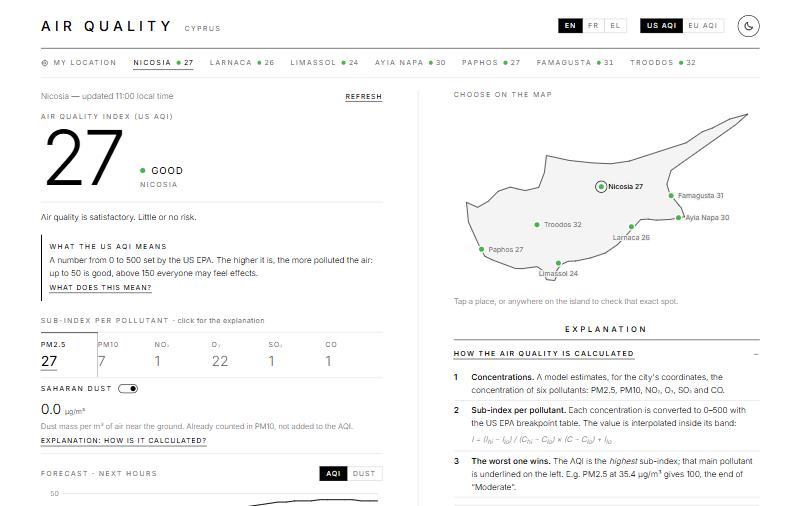
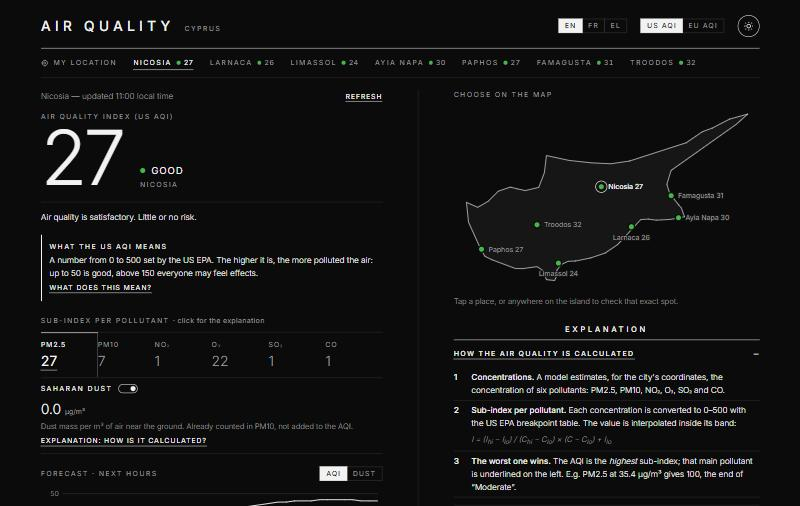
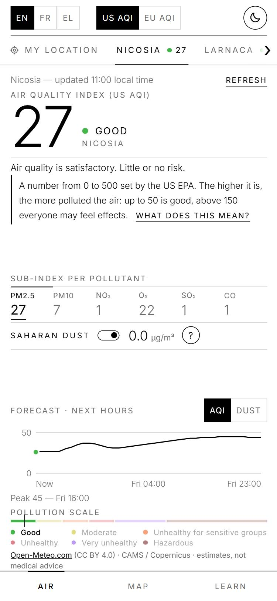

# Air Quality — Cyprus

A small, dependency-free web app that shows the current air quality and a 48-hour forecast for the main places of Cyprus: **Nicosia, Larnaca, Limassol, Ayia Napa, Paphos, Famagusta and Troodos**, or any spot you tap on the map, or your own position. It is an offline-ready web app (PWA).

| Light | Dark | Phone |
| --- | --- | --- |
|  |  |  |

> Live demo: _add your GitHub Pages link here once the site is published._

## Features

- **US AQI and European AQI** (switch in the header), with the level, health advice and a pointer on the scale. A "What does this mean?" link and an **"US AQI or EU AQI?"** explanation say who publishes each index, its scale, its pollutants and levels, and show what both indices say about the current place. A **"What each level means"** section explains every level of the chosen index (Good, Moderate, Unhealthy for sensitive groups… or Good, Fair, Moderate, Poor…): what it means, which precautions to take and who the sensitive groups are. The current level is highlighted and open.
- **Seven places at a glance**: each place in the picker shows its current value.
- **Interactive map of Cyprus**: tap a place, or **tap anywhere on the island** to get the air quality of that exact spot (a "Pinned point"). Keyboard accessible.
- **Sub-index for each of the six pollutants** (PM2.5, PM10, NO₂, O₃, SO₂, CO). The main pollutant, the one that sets the AQI, is underlined.
- **Explanations** for how the AQI is calculated, what each pollutant is, and how Saharan dust is calculated.
- **Saharan dust** reading (switchable) and **hourly forecast chart** for the AQI or the dust (hover or touch the chart for values).
- **My location** (browser geolocation, rounded to about 1 km, never stored), shown on the map when you are in Cyprus.
- **Offline-ready (PWA)**: the app shell is cached by a service worker, so it opens without a connection. Your browser's own menu can still add it to the home screen.
- **English, French and Greek**; the language follows your browser unless you choose one.
- **Dark mode**, remembered; follows your system by default.
- Resilient: the last data is cached for 30 minutes and still shown, as an "offline copy", if the network fails. Requests time out after 10 s and can be retried.
- Shareable links: `?city=paphos&lang=el&index=eu`.
- **Built for phones, adapted to every screen**: on small screens the app is a fixed, app-like screen that **fits the display without scrolling**: a one-row header, a swipeable strip of places (with arrows showing there is more to swipe), the content of the current section, and a small bottom tab bar (**Air / Map / Learn**). Sizes follow the screen height, so a 320x568 phone, a tall 412x915 phone, a landscape phone (three columns) and a portrait tablet each get a layout that fits; only the long Learn section scrolls inside its area on short screens. Choosing a place on the map takes you back to the air quality view, you can **swipe left or right** to move between sections, layouts respect notches and the home indicator, the browser bar takes the theme colour, and a **Share** button opens the phone's share sheet.
- Responsive from 320 px phones to wide desktops: two columns above 900 px, a single column below (tablets, landscape phones).
- Accessible: keyboard navigation, `aria-live` status, reduced-motion support.

## Data and accuracy

Data comes from the [Open-Meteo Air Quality API](https://open-meteo.com/en/docs/air-quality-api) (free for non-commercial use, no API key), which serves the **CAMS European air-quality forecast** of the Copernicus Atmosphere Monitoring Service.

- Resolution: about 11 km in Europe (about 45 km outside Europe, for "My location"), hourly values, model run updated about once a day.
- These are **model estimates**, not readings from a sensor in the city, so nearby places can show almost the same value.
- The US AQI uses the US EPA breakpoints, with 24 h rolling averages for particles and 8 h for ozone and carbon monoxide. Values are interpolated inside each band and the AQI is the highest of the pollutant sub-indices. The European AQI uses the European Environment Agency bands (it has no CO sub-index).
- The dust value is the Saharan dust mass near the ground in µg/m³. There is no official dust scale.

**This app is informational only. It is not an official source and not medical advice.**

## Run it locally

No build step and no dependencies. Serve the folder with any static server:

```bash
python -m http.server 8000
```

Then open <http://localhost:8000>.

The service worker only runs on `localhost` or HTTPS. It fetches files from the network first and uses its cache only when offline or on a very slow connection, so changes show up on the next reload. Bump `VERSION` in `sw.js` when you add, remove or rename a file of the app shell; when a new version takes over, open pages reload once automatically.

## Tests

The logic lives in `aqi.js` (levels, parsing, helpers) and `map.js` (projection, island outline). Neither touches the DOM or the network, and both are covered by tests using Node's built-in runner (Node 18+):

```bash
npm test
```

GitHub Actions runs the same tests on every push and pull request (`.github/workflows/ci.yml`).

## Publish with GitHub Pages

The site is fully static. In the repository go to **Settings → Pages**, choose **Deploy from a branch**, branch `main`, folder `/ (root)`. The API is served over HTTPS, so it works on Pages as is.

## Project structure

```
index.html   page structure
style.css    layout, themes, responsive rules (monochrome design)
aqi.js       pure logic: scales, levels, parsing, helpers (unit-tested)
map.js       island outline and map projection (unit-tested)
i18n.js      English / French / Greek strings
main.js      UI, fetching, cache, chart, map, geolocation, service worker registration
sw.js        service worker (offline app shell)
manifest.webmanifest, icons/   PWA manifest and icons
fonts/       Inter (self-hosted, SIL Open Font License)
test/        unit tests
docs/        screenshots
```

To add a place, append `{ id, lat, lon, label }` to `CITIES` in `main.js` (`label` is where its name sits next to the dot on the map: `r`, `l`, `t` or `b`) and a `city.<id>` name in each language of `i18n.js`.

## Privacy

No cookies, no analytics, no third-party fonts. The only network request is to the Open-Meteo API, with the coordinates of the places shown (the seven places, plus your rounded position or the spot you tapped on the map, if any). Those two points are kept in memory only. Preferences (theme, language, index, dust switch, last place) and a short-lived data cache are stored in your browser's `localStorage`; the service worker caches the app's own files only.

## Credits and licence

- Code: [MIT](LICENSE).
- Air quality data: [Open-Meteo.com](https://open-meteo.com/) ([CC BY 4.0](https://creativecommons.org/licenses/by/4.0/)). Contains modified Copernicus Atmosphere Monitoring Service information (CAMS ENSEMBLE data provider).
- Font: [Inter](https://rsms.me/inter/) by The Inter Project Authors, SIL Open Font License 1.1 (`fonts/OFL.txt`).
- Island outline: simplified from the [Natural Earth](https://www.naturalearthdata.com/) 1:50m land polygon (public domain). It shows the island as a whole and is not a political map.
- Translations (French, Greek) and health wording are written for this project: corrections are welcome.

## Ideas

Pollen and UV index, comparison with WHO guidelines, alerts for dust episodes, readings from monitoring stations.
